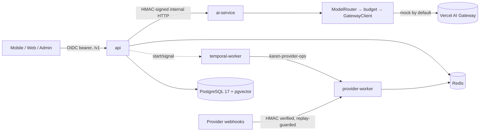

# Architecture summary

Sources: `karen_architecture.md` (technical source of truth, v2.0, 19 Nov 2026) and `karen.md` (product specification v1.0). The task brief named these `KAREN_WORLD_CLASS_TECH_ARCHITECTURE_2026.md` and `KAREN_COMPLETE_PRODUCT_MASTER_SPEC_AUDITED_v1.1.md`; the repository contains them under the shorter names above (the product spec is v1.0, not "audited v1.1"). Neither original has been modified.

## What KAREN is

A goal-driven, permission-based, accountable personal AI agent (India-first). The LLM may **propose**; only backend code with explicit consent, approval and provider verification may **act**. "Attempted is not completed."

## Three execution planes

| Plane       | Purpose                                                                             | Implemented in                                                  |
| ----------- | ----------------------------------------------------------------------------------- | --------------------------------------------------------------- |
| Interactive | Auth, profile, chat, retrieval, streaming model calls, voice                        | `apps/api`, `apps/ai-service`, `apps/voice-agent`, clients      |
| Action      | Approval-gated, durable, idempotent provider actions with verification and recovery | `apps/temporal-worker`, `apps/provider-worker`, `@karen/domain` |
| Background  | Webhooks, reminders, memory extraction, evals, cost reconciliation                  | provider-worker webhooks; rest arrives with features            |

## Deployables (7, within the 5–7 target)

1. **api** — NestJS 12/Fastify BFF + core domains (identity, consent, audit, policy, admin; future: conversations, memory, goals, tasks, approvals, notifications, billing).
2. **ai-service** — Python FastAPI: ModelRouter, budget/policy, GatewayClient (Vercel AI Gateway), LangGraph, evals.
3. **temporal-worker** — Responsibility Engine workflows (`karen-tasks`).
4. **provider-worker** — provider adapters as Temporal activities (`karen-provider-ops`) + signed webhook ingress.
5. **voice-agent** — LiveKit worker (pilot; audio NOT verified).
6. **web** and 7. **admin** — Next.js (hosting target deferred). **mobile** ships through app stores, not as a server deployable.

## Request paths

## Non-negotiables encoded in code (not prompts)

- Deny-by-default execution policy: `decideExecution` (`@karen/domain`) — unknown/model-invented categories are PROHIBITED; HIGH risk always needs fresh, transaction-specific approval; kill switch and consent checked first.
- Approval binding: payload hash, subject, provider, currency, max amount, expiry, step-up assurance for HIGH risk (`verifyExecutionAgainstApproval`).
- Task state machine with evidence-gated completion and optimistic concurrency (ADR-0003).
- Provider capability declarations validated at registration; search-only providers cannot transact.
- Gateway key server-side only; client bundles guarded by `pnpm check:env-public`.

See [implementation-decisions.md](implementation-decisions.md) for findings and deviations, [service-boundaries.md](service-boundaries.md), [dependency-map.md](dependency-map.md), [repository-structure.md](repository-structure.md) and [infrastructure.md](infrastructure.md).
