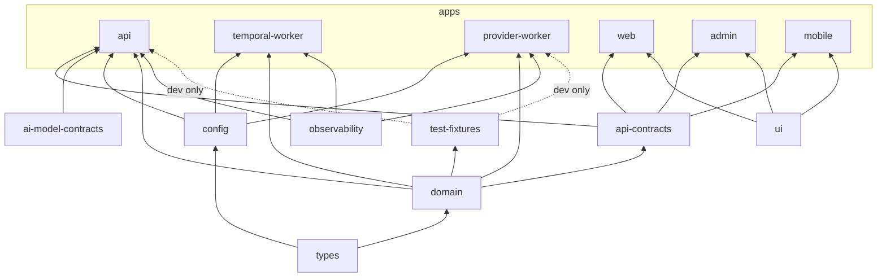

# Dependency map

## Internal package graph (TypeScript)

Python services depend on no TS package at runtime; they share **data** (JSON fixtures, signature vectors) with TS for contract tests.

## Key third-party dependencies (pinned)

| Area           | Packages                                                                                                                                                               |
| -------------- | ---------------------------------------------------------------------------------------------------------------------------------------------------------------------- |
| Runtime        | Node 24 LTS, Python 3.12                                                                                                                                               |
| Backend        | @nestjs/* 12.4.2, fastify 5.12.8, @nestjs/swagger 12.1.1, @nestjs/throttler 6.7.1, nestjs-pino 5.3.1, jose 6.2.17, ioredis 5.11.1                                      |
| Data           | prisma / @prisma/client / @prisma/adapter-pg 7.10.1, pg 8.23.1, PostgreSQL 17 + pgvector 0.8.7                                                                         |
| Workflows      | @temporalio/* 1.25.0, Temporal CLI dev server 1.10.1                                                                                                                   |
| Contracts      | zod 4.6.7, openapi-typescript 7.13.0, openapi-fetch 0.17.0                                                                                                             |
| Web            | next 16.4.6, react 19.3.0, tailwindcss 4.3.5, @tanstack/react-query 5.107.1                                                                                            |
| Mobile         | expo 58.0.24, react-native 0.88.1, expo-router 58.0.31, expo-secure-store 58.0.3, zustand 5.1.0                                                                        |
| Observability  | pino 10.4.0, @opentelemetry/sdk-node 0.301.1, @sentry/node 11.12.0                                                                                                     |
| AI (Python)    | fastapi 0.162.0, pydantic 2.14.2, openai 3.45.0, langgraph 1.2.19 (see apps/ai-service/pyproject.toml)                                                                 |
| Voice (Python) | livekit-agents 1.8.10                                                                                                                                                  |
| Tooling        | typescript 6.0.3, eslint 10.14.0, typescript-eslint 8.72.2, vitest 4.1.12, jest 30.5.2 (mobile), playwright 1.65.0, turbo 2.11.10, prettier 3.10.0, ruff, mypy, pytest |
| IaC            | terraform ≥ 1.11, hashicorp/aws ~> 6.73                                                                                                                                |
