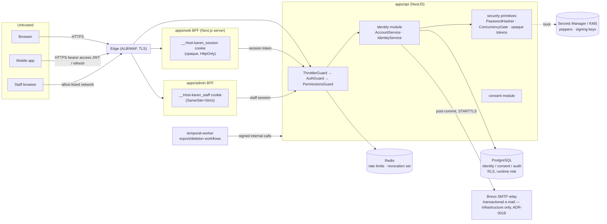
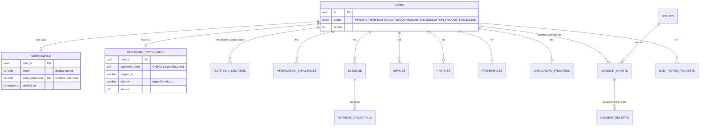
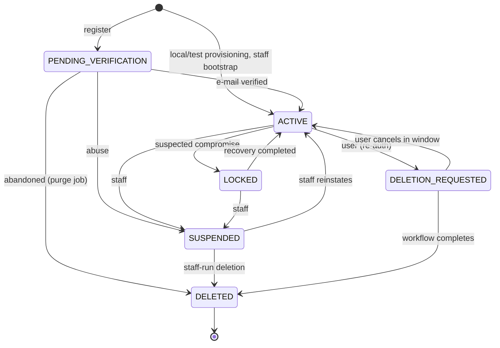
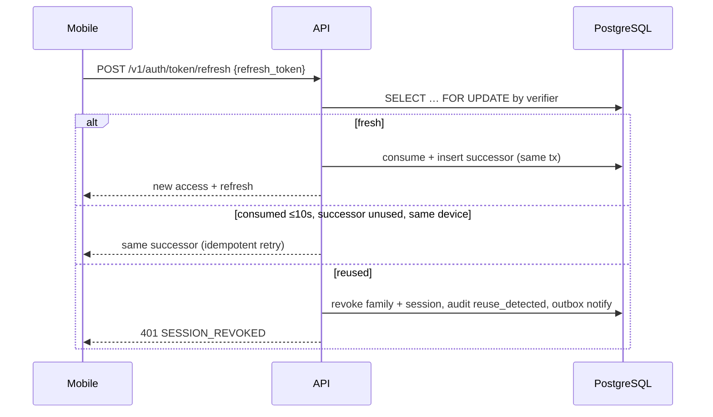

# First-party identity & access architecture (Phase 01)

Status: design for Phase 01 M0, implemented incrementally (status per milestone in
`docs/PHASE_01_PLAN.md`). Decisions: ADR-0015 (first-party identity), ADR-0016 (sessions/tokens),
ADR-0017 (staff realm). Anything marked **NOT VERIFIED** has no test or measurement yet.

## 1. Principles

1. Authentication ≠ authorization ≠ consent. Each is checked by different code and has its own error
   code (`UNAUTHENTICATED` / `FORBIDDEN`, `ACCOUNT_INACTIVE` / `CONSENT_REQUIRED`).
2. Identity is derived only from a server-verified credential, never from request input.
3. Accounts are created only by explicit provisioning — never by authenticating.
4. Every security decision fails closed. A degraded dependency produces a retryable 503, not a
   weaker check.
5. Secrets (passwords, OTPs, tokens, peppers, signing keys) are never logged, never returned after
   issue, and stored only as verifiers.
6. One module (`apps/api/src/identity` + `src/security`), one schema (`identity`; `staff` in M8). No
   new deployable.

## 2. Components and trust boundaries



Boundaries and what crosses them:

| Boundary                     | Crossing                                       | Control                                                                                                          |
| ---------------------------- | ---------------------------------------------- | ---------------------------------------------------------------------------------------------------------------- |
| Client → edge                | Passwords (once), cookies, bearer tokens       | TLS only; HSTS; WAF rate rules; body limit                                                                       |
| Browser → web BFF            | Opaque session cookie                          | `__Host-` prefix, HttpOnly, Secure, SameSite=Lax; Origin check + CSRF token on mutations; nonce CSP              |
| BFF/mobile → API             | Session token / access JWT                     | Global AuthGuard; realm + audience separation; per-request liveness check                                        |
| API → PostgreSQL             | Runtime role (no BYPASSRLS, no DDL, no DELETE) | RLS per user (`karen.user_id` transaction-local); pre-auth reads only via exact-match SECURITY DEFINER functions |
| API → Redis                  | Rate counters, revocation set                  | Never authoritative; sensitive limiter fails closed (ADR-0013)                                                   |
| API → Brevo (e-mail)         | Recipient, template id, one-time code          | Post-commit in-memory dispatch (codes never at rest), STARTTLS; provider sees codes (accepted risk, ADR-0018)    |
| Staff realm ↔ consumer realm | Nothing                                        | Separate tables, cookies, audiences; cross-realm tests (ADR-0017)                                                |

## 3. Data model

Implemented in M1 (solid) and planned (later milestones). Table names below are canonical; they
resolve the naming conflicts listed in `docs/PHASE_01_PLAN.md` §3.



| Table (schema `identity` unless noted)           | Milestone | Key constraints / indexes                                                                                                    | RLS                                  |
| ------------------------------------------------ | --------- | ---------------------------------------------------------------------------------------------------------------------------- | ------------------------------------ |
| `users`                                          | existing  | status trigger (state machine); default `PENDING_VERIFICATION`                                                               | own row                              |
| `user_emails`                                    | **M1**    | UNIQUE(`user_id`), UNIQUE(`email_canonical`), CHECK canonical lower-case/shape, CHECK display↔canonical                      | own row; not FORCEd (definer lookup) |
| `password_credentials`                           | **M1**    | PK `user_id`; CHECK argon2id prefix and length; `version` for rehash/change races                                            | own row; not FORCEd (definer lookup) |
| `external_identities`                            | existing  | UNIQUE(`issuer`,`subject`)                                                                                                   | own row                              |
| `verification_challenges`                        | M2        | purpose (`email_verify`/`password_reset`/`email_change`), handle verifier UNIQUE, code verifier, attempts, expires, consumed | own row + definer lookup by handle   |
| `sessions`, `refresh_credentials`, `devices`     | M3        | session verifier UNIQUE; `(user_id, revoked_at)`; refresh verifier UNIQUE, `(family_id, generation)` UNIQUE                  | own row + definer lookup by verifier |
| `profiles`, `preferences`, `onboarding_progress` | M4/M5     | PK `user_id`; `version` (ETag)                                                                                               | own row, FORCEd                      |
| `consent.notices`                                | M6        | UNIQUE(`kind`,`locale`,`version`); `content_sha256`; `state` draft/approved; approved rows immutable (trigger)               | read-only to runtime                 |
| `consent.consent_grants` (existing name kept)    | M6        | current state per (user, purpose, scope)                                                                                     | own row, FORCEd                      |
| `consent.consent_receipts`                       | M6        | append-only (trigger), hash chain per user (`prev_hash`, `receipt_hash`)                                                     | own row, FORCEd                      |
| `consent.legal_acceptances` (existing)           | M6        | UNIQUE(user, document, version)                                                                                              | own row, FORCEd                      |
| `consent.data_rights_requests`                   | M7        | kind export/deletion, state machine, UNIQUE active request per (user, kind)                                                  | own row, FORCEd                      |
| `staff.*`                                        | M8        | ADR-0017                                                                                                                     | staff-realm role                     |

Soft vs hard delete: `users` rows become `DELETED` tombstones (status + scrubbed PII) so foreign keys
and audit references stay intact; credential, e-mail, session, profile and preference rows are
**hard-deleted** by the M7 deletion worker (a separate DB role with DELETE; the request-path runtime
role has no DELETE anywhere). Audit rows are append-only and contain only UUIDs and reason codes.

## 4. Account state machine



Access: only `ACTIVE` = full; `DELETION_REQUESTED` = only view/cancel-deletion routes (M7); all other
statuses = none (`ACCOUNT_INACTIVE`). Enforced in `@karen/domain` + DB trigger; parity test in
`apps/api/test/identity.int.test.ts`.

## 5. E-mail canonicalization (implemented: `canonicalizeEmail`)

Trim; reject whitespace/control characters; exactly one `@`; local part = ASCII dot-atom ≤ 64
(SMTPUTF8 local parts rejected with `UNSUPPORTED_LOCAL_PART` until the mail path is verified); domain
IDNA → punycode via WHATWG URL, lower-case, ≥ 2 labels, valid labels, no IP literals, trailing dot
removed; total ≤ 254. Canonical = lower(local) + `@` + domain. **No** Gmail-style dot/plus folding.

## 6. Sequences

### 6.1 Registration and e-mail verification (M2)

Pre-account-takeover defence: the verification code is bound to a **registration handle** held only
by the client that registered, so a victim clicking/typing a code from an attacker-initiated
registration cannot complete it, and an attacker cannot complete a registration for a mailbox they
do not read.

```mermaid
sequenceDiagram
  participant C as Client
  participant A as API
  participant DB as PostgreSQL
  participant O as MailService→Brevo
  C->>A: POST /v1/auth/register {email, password, locale}
  A->>A: canonicalize, policy check, Argon2id hash (gate)
  alt e-mail free
    A->>DB: tx: users(PENDING), user_emails, password_credentials, challenge, audit
    A-->>O: after commit: verification code mail (per-address budget)
  else e-mail taken
    A-->>O: "you already have an account" mail; respond with a decoy handle (matches nothing)
  end
  A-->>C: 202 {registration_handle (kev_…), expires_at}  — identical shape in both cases
  O-->>C: e-mail: 6-digit code (15 min)
  C->>A: POST /v1/auth/verify-email {registration_handle, code}
  A->>DB: lock challenge; check attempts (≤5), expiry, constant-time code compare
  A->>DB: tx: user_emails.verified_at, status PENDING→ACTIVE, consume challenge, audit
  A-->>C: 200 → client proceeds to login (no auto-session in Phase 01)
```

Implemented (M2): a second registration for an existing address never changes that account. The
mailbox owner reclaims an address an attacker registered (unverified) through **forgot password**:
completing a reset proves mailbox ownership, replaces the credential, marks the e-mail verified,
activates the account and closes every other open code (test: "pre-account takeover").

### 6.2 Login (M2/M3)

```mermaid
sequenceDiagram
  participant C as Client/BFF
  participant A as API
  participant R as Redis
  participant DB as PostgreSQL
  C->>A: POST /v1/auth/login {email, password, device}
  A->>R: sensitive limiter (IP) + account limiter (canonical-email hash) — fail closed
  A->>DB: lookup_password_login(canonical)
  A->>A: Argon2id verify or dummy verify (uniform cost)
  alt invalid
    A->>DB: audit login_failed; increment account failure counter
    A-->>C: 401 INVALID_CREDENTIALS (generic)
  else valid but not ACTIVE
    A-->>C: 403 ACCOUNT_INACTIVE {reason: pending_verification|locked|suspended}
  else valid
    A->>DB: tx: session, refresh family (mobile), device upsert, audit, new-device notice via outbox
    A-->>C: web: session token (BFF sets cookie) · mobile: access JWT + refresh token
  end
```

Throttling: per IP (sliding window, fail closed), per account (exponential delay after 5 failures,
temporary lock 15 min after 20 in 24 h — lock is per account+IP-prefix to avoid trivial lockout DoS),
global hashing gate. CAPTCHA/bot challenge hook after repeated failures (provider decision pending).

### 6.3 Refresh, logout, revocation (M3) — see ADR-0016 for the algorithm



### 6.4 Password reset (M2)

`POST /v1/auth/password/forgot` always returns 202 (no enumeration), rate-limited per IP and per
canonical e-mail; issues a `password_reset` challenge (handle + 6-digit code, or a single-use
256-bit link token, 15 min). `POST /v1/auth/password/reset` verifies, sets the new password (policy
applied), bumps credential version, **revokes all sessions** by default, notifies the user, unlocks
`LOCKED` accounts (LOCKED→ACTIVE), and does **not** sign the user in. Accounts with WebAuthn/MFA
(future consumer MFA) require that factor in addition to e-mail. No security questions.

### 6.5 Staff sign-in with WebAuthn (M8) — ADR-0017

Password → WebAuthn assertion (UV required) → staff session (15 min idle / 8 h) → step-up assertion
for sensitive operations → JIT elevation with reason/ticket.

### 6.6 Account deletion (M7)

Re-authenticate (password ≤ 5 min) → `ACTIVE→DELETION_REQUESTED` + revoke sessions + request row →
Temporal workflow (idempotent, workflow id = request id) waits the cancellation window (proposed
7 days, **needs legal review**) → deletes per store (PostgreSQL rows, Redis keys, object storage,
vectors, provider tokens, analytics ids), each step recorded → status `DELETED` tombstone → receipt.
Backups age out per retention (documented, not instant); audit rows keep UUID only; legal retention
exceptions recorded per category.

## 7. API inventory (Phase 01)

Auth levels: **P** public · **S** authenticated session (ACTIVE) · **R** recent re-auth (≤ 5 min) ·
**D** deletion-pending session allowed · **T** staff realm · **TS** staff step-up · **C** consent
gate. All routes `/v1`, Zod contracts in `@karen/api-contracts`, errors in the standard envelope.

| Route                                                                           | Auth                 | Idempotency                                                     | Milestone |
| ------------------------------------------------------------------------------- | -------------------- | --------------------------------------------------------------- | --------- |
| `POST /auth/register`                                                           | P                    | natural (canonical e-mail)                                      | **M2 ✔**  |
| `POST /auth/verify-email`, `POST /auth/challenges/resend`                       | P                    | single-use; resend rotates the code                             | **M2 ✔**  |
| `POST /auth/login`                                                              | P                    | none (each success = new session)                               | **M3 ✔**  |
| `POST /auth/password/forgot`, `POST /auth/password/reset`                       | P                    | single-use challenge                                            | **M2 ✔**  |
| `POST /auth/token/refresh`                                                      | P (refresh token)    | 10 s same-installation retry returns the same successor         | **M3 ✔**  |
| `POST /auth/logout`, `POST /auth/logout-all`                                    | S                    | idempotent                                                      | **M3 ✔**  |
| `GET /me`                                                                       | S                    | —                                                               | existing  |
| `GET /me/sessions`, `DELETE /me/sessions/:id`                                   | S                    | idempotent delete; other users' ids → 404                       | **M3 ✔**  |
| `GET /me/devices`, `DELETE /me/devices/:id`                                     | S                    | idempotent delete; other users' ids → 404                       | **M3 ✔**  |
| `GET/PATCH /me/profile`                                                         | S                    | `If-Match` (ETag = version) → 428 missing / 412 stale           | **M4 ✔**  |
| `GET/PATCH /me/preferences`; `GET/POST /me/places`, `PUT/DELETE /me/places/:id` | S                    | `If-Match` on PATCH/PUT/DELETE; ≤ 20 places                     | **M4 ✔**  |
| `POST /me/email-change`, `POST /me/email-change/confirm`                        | S + current password | code to the NEW address; decoy if taken; other sessions revoked | **M4 ✔**  |
| `POST /me/password`                                                             | S + current password | other sessions revoked; throttled like sign-in                  | **M4 ✔**  |
| `GET/PUT /me/onboarding`                                                        | S                    | step transitions idempotent                                     | M5        |
| `GET /consent/notices`, `GET /consent/notices/:kind/:version`                   | P                    | —                                                               | M6        |
| `GET /me/consents`, `PUT /me/consents/:purpose`, `GET /me/consents/history`     | S                    | `Idempotency-Key` + per-purpose version                         | M6        |
| `GET /me/consents/receipts/:id/verify`                                          | S                    | —                                                               | M6        |
| `POST /me/data-rights/export`, `POST /me/data-rights/deletion`                  | R / D                | one active request per kind                                     | M7        |
| `GET /me/data-rights/:id`, `POST /me/data-rights/:id/cancel`                    | S / D                | idempotent                                                      | M7        |
| `/staff/auth/*`, `/staff/*`                                                     | T / TS               | per route                                                       | M8        |

Naming resolution: the roadmap's `/v1/consent/grants`, `/v1/consent/requests`,
`/v1/data-rights/export` and `/v1/identity/bootstrap` are replaced by the user-scoped `/v1/me/...`
forms above (the subject is always the caller, so the path never carries a user id), and bootstrap
is dropped (ADR-0015 §1).

**Error codes** (existing + Phase 01): `VALIDATION_FAILED`, `UNAUTHENTICATED`, `FORBIDDEN`,
`ACCOUNT_INACTIVE` (M1), `CONSENT_REQUIRED`, `CONFLICT`, `RATE_LIMITED`, `DEPENDENCY_UNAVAILABLE`;
M2: `WEAK_PASSWORD` (400, reasons in `details`), `CHALLENGE_INVALID` (400; invalid, expired, used and
exhausted are deliberately indistinguishable). Planned: `INVALID_CREDENTIALS`,
`REAUTHENTICATION_REQUIRED`, `SESSION_REVOKED`, `PRECONDITION_FAILED` (412).

## 8. Dependency failure behaviour

| Dependency down         | Behaviour                                                                                                                                                                                      |
| ----------------------- | ---------------------------------------------------------------------------------------------------------------------------------------------------------------------------------------------- |
| Redis                   | Sensitive (auth) routes: 503 retryable (fail closed, ADR-0013). Session liveness: falls back to PostgreSQL. Other routes: per-process rate limit fallback. **Login/registration unavailable.** |
| PostgreSQL              | All authenticated and auth routes 503; liveness stays up; nothing is authorized from cache.                                                                                                    |
| E-mail provider (Brevo) | Bounded in-process retries (1/4/15 s); registration/forgot still return 202; user can resend (rotates code); nothing is reported as delivered that the relay did not accept.                   |
| KMS / signing key       | No new mobile access tokens (refresh → 503); web sessions unaffected (opaque); existing JWTs verify from cached public keys.                                                                   |
| Hashing capacity        | 503 retryable `DEPENDENCY_UNAVAILABLE`; parameters are never lowered under load.                                                                                                               |

## 9. Consistency

Strong (single PostgreSQL transaction): account creation, status transitions, credential changes,
session issue/revoke, refresh rotation, consent grant/revoke + receipt, data-rights state.
Eventually consistent (outbox): notification e-mails, analytics, deletion propagation to secondary
stores (tracked per step, reported to the user as in progress).

## 10. Performance budgets (PROPOSED — NOT VERIFIED; measured in M10)

| Operation                     | p95 budget (API, excl. network) | Notes                                                                                                                |
| ----------------------------- | ------------------------------- | -------------------------------------------------------------------------------------------------------------------- |
| Login                         | ≤ 300 ms                        | dominated by one Argon2id verify (≈ 42 ms p50 on the dev laptop with v1 params; Fargate unmeasured) + 2–3 queries    |
| Session/access validation     | ≤ 10 ms                         | one Redis `SISMEMBER` or one PK read; plus existing principal resolution (1 txn) — to be merged into one query in M3 |
| Token refresh                 | ≤ 50 ms                         | one locked row + one insert                                                                                          |
| Profile read                  | ≤ 30 ms                         | one scoped query                                                                                                     |
| Consent check                 | ≤ 10 ms                         | indexed `(user_id, purpose, status)`                                                                                 |
| Authorization decision        | ≤ 1 ms                          | in-memory from principal                                                                                             |
| Hashing capacity per API task | ≈ (vCPU-bound) ~4 concurrent    | 4 × 64 MiB = 256 MiB peak hashing memory per task; size tasks accordingly                                            |
