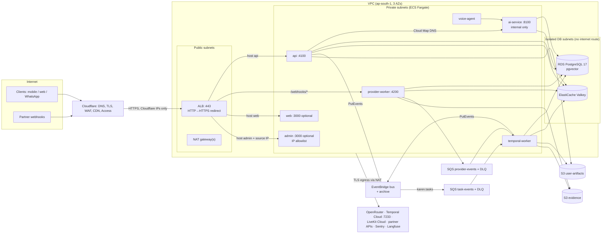

# KAREN infrastructure (AWS, Terraform)

Source of truth: `infra/terraform/` (see its README). Derived from `karen_architecture.md`
§1 (topology), §8 (data/eventing), §9 (cloud: Mumbai `ap-south-1`, ECS/Fargate, Multi-AZ,
private subnets), §10 (KMS, Secrets Manager, least privilege) and §15 (what we avoid).
**Not yet applied to any account.**

## Topology

## Trust boundaries

| #   | Boundary              | Control                                                                                                                                                                                                                           |
| --- | --------------------- | --------------------------------------------------------------------------------------------------------------------------------------------------------------------------------------------------------------------------------- |
| 1   | Internet → Cloudflare | Cloudflare WAF/DDoS/bot rules, TLS (configured outside Terraform).                                                                                                                                                                |
| 2   | Cloudflare → ALB      | ALB SG ingress only from `alb_ingress_ipv4_cidrs` (Cloudflare ranges); HTTPS with TLS 1.2+/1.3 policy; invalid headers dropped; unknown hosts get a 404 fixed response. Recommended next step: Authenticated Origin Pulls (mTLS). |
| 3   | ALB → services        | SG-to-SG rules to exactly one container port per service; webhooks routed by path to `provider-worker` only; services verify webhook signatures (`PROVIDER_WEBHOOK_SECRETS`).                                                     |
| 4   | Service → service     | `ai-service` accepts traffic only from the `api` and `voice-agent` SGs; requests carry `INTERNAL_SERVICE_HMAC_SECRET` signatures. Traffic is plain HTTP inside the VPC (no mTLS yet; ECS Service Connect TLS is a later option).  |
| 5   | Services → data       | RDS/Redis in isolated subnets, reachable only from the four data-owning service SGs; TLS enforced (`rds.force_ssl=1`, ElastiCache `transit_encryption_mode=required`); per-service DB roles; Redis AUTH token.                    |
| 6   | Services → AWS APIs   | Per-service task roles: own queues, own buckets (object-level), own bus; KMS use limited by `kms:ViaService`. Per-service execution roles: own image, own log group, **own secrets only**.                                        |
| 7   | Services → internet   | Egress only to TLS ports (443, Temporal 7233, LiveKit UDP media) through NAT. FQDN allowlisting isn't done yet (needs Network Firewall/egress proxy).                                                                             |
| 8   | Operators → secrets   | Terraform creates secret containers only; values are set out-of-band. The RDS master secret is managed by RDS and isn't granted to services.                                                                                      |

### Secret → service matrix

| Secret                                                 | api | ai-service | temporal-worker | provider-worker | voice-agent | web/admin |
| ------------------------------------------------------ | :-: | :--------: | :-------------: | :-------------: | :---------: | :-------: |
| INTERNAL_SERVICE_HMAC_SECRET, LOG_PSEUDONYMIZATION_KEY |  ✓  |     ✓      |        ✓        |        ✓        |      ✓      |           |
| SENTRY_DSN                                             |  ✓  |     ✓      |        ✓        |        ✓        |      ✓      |     ✓     |
| OPENROUTER_API_KEY                                     |     |     ✓      |                 |                 |             |           |
| LANGFUSE_PUBLIC_KEY / SECRET_KEY                       |     |     ✓      |                 |                 |             |           |
| TEMPORAL_ADDRESS / NAMESPACE / API_KEY                 |  ✓  |            |        ✓        |        ✓        |             |           |
| LIVEKIT_API_KEY / SECRET                               |  ✓  |            |                 |                 |      ✓      |           |
| PROVIDER_WEBHOOK_SECRETS                               |     |            |                 |        ✓        |             |           |
| DATABASE_URL (own role)                                |  ✓  |     ✓      |        ✓        |        ✓        |             |           |
| REDIS_AUTH_TOKEN                                       |  ✓  |     ✓      |        ✓        |        ✓        |             |           |

### Admin exposure

The admin app is off by default (`enable_admin = false`) and **must never be public**.
Enabling it requires `admin_allowed_cidrs` (validated non-empty, never `0.0.0.0/0`). Those
CIDRs are enforced by an ALB `source-ip` rule condition and added to the ALB SG. The
`source-ip` condition sees the **immediate peer**, so pick one model:

1. **DNS-only (grey-cloud) admin hostname**: office/VPN egress CIDRs reach the ALB directly.
   The allowlist works as written.
2. **Cloudflare-proxied with Cloudflare Access**: the ALB sees Cloudflare IPs, so the ALB
   allowlist can't distinguish users. Enforce identity at Cloudflare Access, add
   Authenticated Origin Pulls, and have the admin app verify the `Cf-Access-Jwt-Assertion`
   JWT. This needs a code change before you choose it.
3. **Vercel**: if web/admin move to Vercel, keep `enable_web`/`enable_admin` false and
   protect admin with Vercel/Cloudflare Access.

In every case the admin app enforces its own staff authentication and RBAC (§10).

## Resources per environment

| Resource                                                      | dev                                                                          | staging                                                           | production                                                            |
| ------------------------------------------------------------- | ---------------------------------------------------------------------------- | ----------------------------------------------------------------- | --------------------------------------------------------------------- |
| VPC / AZs                                                     | 10.10.0.0/16, 3 AZs                                                          | 10.20.0.0/16, 3 AZs                                               | 10.30.0.0/16, 3 AZs                                                   |
| NAT gateways                                                  | 1 (shared)                                                                   | 1 (shared)                                                        | 3 (one per AZ)                                                        |
| Interface endpoints (ECR api/dkr, Secrets Manager, Logs, SQS) | off                                                                          | off                                                               | on                                                                    |
| S3 gateway endpoint, VPC flow logs                            | on                                                                           | on                                                                | on                                                                    |
| ECS tasks (min–max per service)                               | 1–2                                                                          | 1–4                                                               | 2–12                                                                  |
| Container Insights                                            | enabled                                                                      | enabled                                                           | enhanced                                                              |
| RDS PostgreSQL 17                                             | db.t4g.small, single-AZ, 20→50 GiB, 7 d PITR, no deletion protection, PI off | db.t4g.medium, single-AZ, 50→200 GiB, 14 d PITR, protected, PI on | db.m7g.large, **Multi-AZ**, 100→1000 GiB, 30 d PITR, protected, PI on |
| ElastiCache (Valkey 8)                                        | 1× cache.t4g.small                                                           | 2× cache.t4g.small, Multi-AZ                                      | 2× cache.m7g.large, Multi-AZ                                          |
| ALB                                                           | 1, deletion protection off                                                   | 1, protected                                                      | 1, protected                                                          |
| S3                                                            | user-artifacts, evidence, alb-logs                                           | same                                                              | same                                                                  |
| SQS                                                           | task-events(+DLQ), provider-events(+DLQ)                                     | same                                                              | same                                                                  |
| EventBridge                                                   | bus + archive 7 d + `karen.tasks` rule                                       | archive 14 d                                                      | archive 90 d                                                          |
| KMS CMKs                                                      | secrets, data, logs, messaging (rotation on)                                 | same                                                              | same                                                                  |
| Log retention                                                 | 14 d                                                                         | 30 d                                                              | 90 d                                                                  |
| Web / admin on ECS                                            | optional (off)                                                               | optional (off)                                                    | optional (off)                                                        |

Encryption at rest: RDS, snapshots, Performance Insights, ElastiCache, S3 data buckets and
ECR use the `data` CMK. Secrets use the `secrets` CMK. Logs use the `logs` CMK. SQS and SNS
use the `messaging` CMK. Two exceptions: the ALB log bucket uses SSE-S3 because ALB access
logs don't support SSE-KMS, and the EventBridge bus uses the AWS-owned key because CMK
support on buses hasn't been verified end to end. Events should carry IDs, not personal data.

Alarms go to the `<env>-alerts` SNS topic: ALB 5xx, unhealthy targets per target group, ECS
CPU/memory per service, RDS CPU/free storage/connections, DLQ depth > 0, EventBridge
FailedInvocations, and an optional monthly budget.
