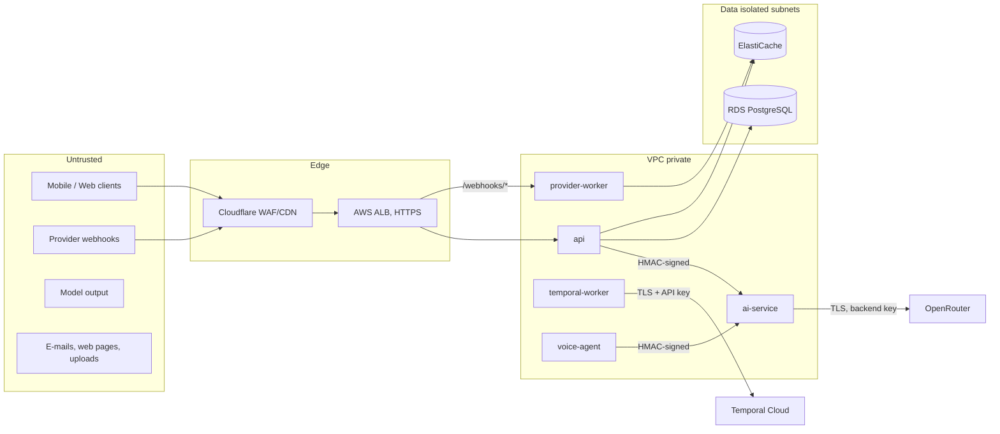

# Security architecture and threat model (foundation)

> Identity (Phase 01): see `identity-threat-model.md` for first-party authentication, sessions, recovery, consent and staff identity threats, residual risks and ASVS traceability.

Scope: the foundation as implemented on 2026-11-19. Re-review per feature (product spec §30 DoD).

## Trust boundaries

| Boundary                   | Control implemented                                                                                                                                                                              | Status                                                    |
| -------------------------- | ------------------------------------------------------------------------------------------------------------------------------------------------------------------------------------------------ | --------------------------------------------------------- |
| Client → API               | OIDC JWT signature + iss/aud/exp + asymmetric alg allow-list; DB-held roles; permission guard; audit of denials                                                                                  | Implemented & tested (local-dev issuer); real IdP pending |
| Client bundles             | No secrets in `NEXT_PUBLIC_*`/`EXPO_PUBLIC_*` (CI guard); gateway key backend-only                                                                                                               | Implemented                                               |
| API → ai-service           | Timestamped HMAC signature (ADR-0007), mandatory when deployed                                                                                                                                   | Implemented & tested (cross-language vectors)             |
| Provider → provider-worker | Per-provider HMAC signature over raw body, timestamp tolerance, replay guard (Redis NX), unknown provider → 404                                                                                  | Implemented & tested (mock provider)                      |
| Model output → actions     | LLM output is untrusted data: categories classified by code (unknown → PROHIBITED); side-effecting tools are proposal-only; execution needs approval verified against payload hash/amount/expiry | Implemented in domain + workflow tests                    |
| Services → data            | Private subnets, per-service DB roles/secrets (Terraform), Postgres schemas per owner, append-only audit trigger                                                                                 | Implemented (IaC not applied)                             |

## STRIDE highlights

| Threat                                            | Mitigation                                                                                                                                                                                                                                    |
| ------------------------------------------------- | --------------------------------------------------------------------------------------------------------------------------------------------------------------------------------------------------------------------------------------------- |
| Spoofed identity / forged JWT                     | Signature verification (never decode-only), `none`/HS* rejected, tests for forged payloads and foreign keys                                                                                                                                   |
| Privilege escalation via token claims             | Roles only from `identity.staff_role_grants`; token `roles` ignored (tested)                                                                                                                                                                  |
| Tampering with approved action                    | Approval bound to canonical-JSON SHA-256 payload hash + amount cap + subject + expiry; mismatch → no execution (tested in workflow)                                                                                                           |
| Replay (webhooks, internal calls, approvals)      | Timestamp tolerance + event-id dedupe; one-time-use internal signatures (Redis, fails closed) + key-rotation window; approvals single-use (first decision wins, `CONSUMED` status in contract)                                                |
| Repudiation                                       | Append-only `audit.audit_events` with request/trace correlation                                                                                                                                                                               |
| Information disclosure in logs                    | pino redaction paths (auth headers, tokens, prompts, messages, e-mail, phone), text scrubber, pseudonymous `user_ref`; Sentry data collection minimised; no prompt content in AI invocation records                                           |
| DoS / cost abuse                                  | Body limits, Redis rate limiting (sensitive routes fail closed; default degrades per-process; proxy hops pinned), AI per-request + **shared atomic** daily budget before gateway calls (fails closed), bounded retries/concurrency — ADR-0013 |
| Excessive agency / prompt injection (OWASP LLM06) | Narrow tool registry; no execute path for side-effecting tools in ai-service; golden eval case for injected "forward my e-mails"                                                                                                              |
| Duplicate side effects                            | Stable idempotency keys; ambiguous results reconciled via status, never blindly retried; duplicate workflow start rejected                                                                                                                    |
| Supply chain                                      | Exact pins, committed lockfiles, 7-day release-age gate, install-script allow-list, OSV + gitleaks in CI                                                                                                                                      |

## Personal memory (Phase 03, ADR-0036 / ADR-0037) — as built 2026-11-24

| Threat                                            | Control (tested)                                                                                                                                                                                                                                                   |
| ------------------------------------------------- | ------------------------------------------------------------------------------------------------------------------------------------------------------------------------------------------------------------------------------------------------------------------ |
| Cross-user memory read/write (S, I, T)            | FORCE RLS on all six `memory.*` tables + explicit `user_id` in every query; composite same-owner FKs; owner triggers on references into `conversation.*` (M2a); wrong-user recall 0 on 900 sealed queries incl. 150 adversarial (M4b)                              |
| Definer functions bypassing isolation (E)         | Per-user-scoped maintenance functions, no time/grace parameters, caller scope restored; only non-owner policies: read-only job lookup, exact-id GUC-gated data-rights lookup (ADR-0037); catalog allow-list test of every SECURITY DEFINER function                |
| Prompt injection via stored memory (T)            | Verbatim-substring rule (model cannot author memory text), shared character policy (TS = Python = SQL, BMP digests), delimited DATA block, opaque refs, no caller system message with memory; 7 golden injection cases (mock) — live model behaviour NOT EVALUATED |
| Model output stored without checks (T, E)         | Deterministic V1–V12 authoritative; model labels escalate-only; mock extractor only; live switch refuses startup (APP-1)                                                                                                                                           |
| Memory resurrection after delete/revoke/clear (I) | Every write step re-reads job, source, thread and consent under the user-row lock; clear cancels in-scope jobs; CAS on job version; race suite T-RACE-01…18                                                                                                        |
| Processing after consent revocation (I)           | Suspension trigger in the revoke transaction; runner re-checks `AI_PROCESSING` at load and while streaming; extraction re-checks before the AI call and before writing                                                                                             |
| Sensitive data stored (I)                         | SECRET / minors / SENSITIVE detectors on the deterministic layer. **Residual:** lexicon false negatives — 2/296 sensitive items on the sealed set (relationship-implied orientation), G-5 not met                                                                  |
| Content in logs/telemetry (I)                     | Redaction keys (TS + Python), counts-only metrics/audit, T-LOG tests, mobile no-log test                                                                                                                                                                           |
| Shared HMAC secret (S)                            | Residual (ADR-0007, L-06): internal endpoints re-derive everything from the job row                                                                                                                                                                                |

## Secrets handling

- Never committed; `.env` files are git-ignored; examples contain only local/test placeholders.
- Deployed secrets live in AWS Secrets Manager (KMS CMK), one container per secret, readable only by the services that need them (Terraform `iam` module).
- Local-dev auth uses an ephemeral in-memory key — there is no static JWT secret anywhere.

## Open items (must be closed before real users)

- Choose IdP; add MFA/passkeys and step-up for HIGH-risk approvals (`acr`/`amr` are already surfaced).
- Postgres RLS as defence in depth for user-owned tables (architecture §5) — table list and mechanism in `data-isolation.md`; per-service DB roles/grants SQL bootstrap.
- Egress filtering (Network Firewall/proxy) — security groups currently allow 443 egress (accepted trivy finding); see `egress-policy.md`.
- Admin console edge identity + staff OIDC session (ADR-0014) before `enable_admin = true`.
- DPDP legal review, data retention schedule, export/deletion jobs (product §24 SEC-05/07).
- Encryption of connector tokens with envelope encryption when connections ship.
