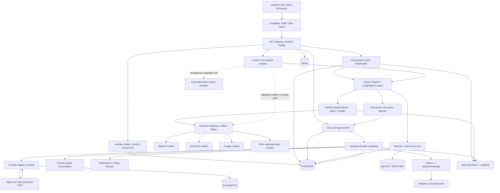

KAREN AI — World-Class Technology Architecture and Feature-to-Tech Blueprint
Version: 2.0 (Vercel AI Gateway reference architecture)
Date: 19 November 2026
Product: KAREN — Personal AI Life Agent
Scope: India-first, designed for international expansion. This document covers the planned platform, not a claim that all third-party integrations are available.
Status: Proposed implementation specification for Claude and the engineering team. Vercel AI Gateway is the primary model gateway and unified AI inference billing account. Validate current model availability, pricing, audio compatibility, and data policies before releasing each workload.
0. Executive architecture decision
KAREN is not simply a chatbot. It is a goal-driven, permission-based, accountable AI system: understand an outcome, identify alternatives, make a recommendation, obtain relevant approval, perform only supported actions, verify authoritative results, monitor consequences, and recover/escalate failures.

Recommended approach: A hybrid modular-service architecture, not dozens of microservices on day one. Separate the latency-sensitive user/AI plane from the durable task/action plane and the asynchronous intelligence/analytics plane.

Initial engineering standards: TypeScript for cross-platform clients and business APIs; Python for AI reasoning, retrieval, and evaluation; Vercel AI Gateway as the primary paid multi-model endpoint; a thin internal KAREN Model Router for task-based model selection; Temporal for durable workflows; PostgreSQL as the source of truth; Redis for ephemeral coordination; approved provider integrations for external actions; AWS infrastructure with security and observability.

Non-negotiable: The LLM may propose an action but must never independently authorise financial, privacy-sensitive, or irreversible external actions. Backend validation, explicit entitlements, transaction approval, connector policy, and provider verification are enforced independently of the LLM.
Technical selection summary
Layer	Decision	Why	Introduce when
Android/iOS	React Native, TypeScript, Expo Development Builds, Expo Router, TanStack Query, Zustand, Reanimated	Shared product development, strong native access, polished interfaces	Immediately
Web app/admin	Next.js, React, TypeScript, Tailwind CSS, shadcn/ui, TanStack Query	Fast app development, server-rendered public pages, accessible component system	Immediately
Business API	NestJS on Fastify, Zod schema contracts, OpenAPI, Prisma or Kysely	Explicit domains, validation, testability; Fastify low overhead	Immediately
AI orchestration	Python 3.12+/FastAPI, Pydantic, LangGraph, provider SDKs	Model ecosystem, structured decisions, eval tooling	Immediately
Primary model gateway	Vercel AI Gateway (https://ai-gateway.vercel.sh/v1) using purchased AI Gateway Credits	One paid gateway account, unified multi-provider access, provider/model fallback and model usage tracking	Immediately
KAREN Model Router	Thin internal Python ModelRouter + GatewayClient abstraction, model registry/config, privacy guardrails	Choose models by task, measured quality/latency/cost; keep application decoupled from Vercel	Immediately
Direct-model alternative	Disabled by default; controlled provider SDK escape hatch for unsupported features or outage	No permanent gateway lock-in, but not single-bill when direct APIs are used	Only after tested need
Model set	Gateway-listed OpenAI, Anthropic, Google, and optionally other providers; choose exact creator/model IDs from live catalog	Route by measured quality and price; no hardcoded global model ranking	Start with 3 tested tiers
Voice	LiveKit/WebRTC; evaluate Vercel AI Gateway audio/realtime/transcription/speech paths and provider-specific direct fallback	Low-latency voice; compatibility is per modality and SDK, audio currently needs extra verification	Pilot then launch
Durable tasks	Temporal Cloud or carefully operated Temporal OSS	Survive process restarts, waiting for user consent, provider delays, retries	Immediately for executed tasks
Primary DB	AWS RDS PostgreSQL Multi-AZ; pgvector; PgBouncer/RDS Proxy as suitable	Strong relational guarantees, auditability, recovery	Immediately
Search/memory	PostgreSQL full-text + pgvector; optional Qdrant hybrid/vector at measured scale	One authoritative data source first; high-quality retrieval	pgvector initially; Qdrant on evidence
Redis	ElastiCache Redis	Rate limits, short-lived sessions, hot cache, short TTL state	Immediately
Durable event fanout	Transactional outbox + SQS/EventBridge; Kafka/MSK if large throughput/stream replay needed	Avoid Kafka operational overhead too early	SQS/EventBridge first
Object store	Private encrypted S3	Audio/documents/evidence exports	Immediately
Edge/CDN	Cloudflare CDN, WAF, bot/DDoS protection	Fast static delivery and defense in depth	Immediately
Container hosting	ECS/Fargate (first) -> EKS with Karpenter/KEDA (when organizational/scale needs justify)	Autoscaling without premature K8s burden	ECS first
Security	OIDC, passkeys, short sessions, KMS, Secrets Manager, policy-as-code and audit	Trust, privacy, least privilege	Immediately
Observability	OpenTelemetry, Grafana/Tempo/Loki/Prometheus or managed equivalents, Sentry, Langfuse	Tail latency, tracing, hallucination/error analysis	Immediately
Analytics	PostHog and an internal event warehouse; ClickHouse for high-volume behavioral analytics	Product iteration, funnels, cost dashboards	Start small; scale later
IaC/CD	Terraform, GitHub Actions, security scans, progressive deploys	Reproducibility and safe changes	Immediately

No tool here is automatically the globally fastest. Production choices are conditional on KAREN-specific quality, latency, reliability, provider access, and cost experiments.
1. Core architectural topology

Three execution planes:
1. Interactive plane: Authentication, profile, chat, low-latency retrieval, Vercel AI Gateway text/model requests, streaming, voice. Return quickly and do not block on multistep bookings.
2. Action plane: Permissioned, long-running tasks, partner APIs, idempotency, approval, verification, reconciliation, compensation and escalation; this plane remains functional even when model inference is temporarily unavailable.
3. Background plane: Provider webhooks and polling, reminders, price checks, opt-in proactivity, memory extraction, cost reporting, evals and analytics.
Recommended first production deployment: 5–7 deployables: mobile/web; NestJS BFF + core domains; Python AI agent with internal model router; Temporal worker; connector worker; voice worker; notification/ingestion worker. Start with shared observability but strict runtime and data boundaries. Use independent microservices only when scaling, deployment ownership, or security needs justify them.

Billing boundary: Vercel AI Gateway is the single primary AI inference bill for supported routed models. AWS compute, LiveKit hosting, Temporal, databases, partner APIs, push providers, maps, and payment processing are separate costs. Direct AI-provider calls, if enabled, also break single-gateway AI billing for those calls.
2. Model platform: Vercel AI Gateway (primary and mandatory)
2.1 Locked decision and rationale
Use Vercel AI Gateway as KAREN's default paid gateway to access multiple model vendors with one gateway key, one gateway credit balance, and centralized gateway request/cost reporting. Python FastAPI can run on AWS; the AI service does not have to run on Vercel. Vercel documents OpenAI-compatible Chat Completions/Responses and Anthropic-compatible Messages interfaces; support varies by model and modality.

No production LiteLLM proxy or second paid aggregator initially. Do not pay an extra routing layer to duplicate gateway capabilities. Keep KAREN's thin internal routing interface, which performs application policy and picks model tiers; let Vercel handle supported upstream routing, health-aware provider selection, provider/model fallbacks, and gateway accounting. Maintain a documented migration path rather than assuming Vercel can never be replaced.

End-to-end inference path:

User message -> API authentication -> context/consent filter -> KAREN ModelRouter -> Vercel AI Gateway -> chosen upstream model -> schema validation/evidence checks -> streamed user response / proposed tools

Never let frontend/mobile devices access the gateway API key. Only approved backend or trusted voice session services may call the gateway.
2.2 Gateway setup and billing rules
- Create a Vercel team/project and an AI Gateway API key. Store AI_GATEWAY_API_KEY in AWS Secrets Manager and inject into backend workloads; do not commit it, expose it to client bundles, or return it via browser/mobile API.
- Purchase AI Gateway Credits and use the Vercel gateway billing balance for routed inference; use no provider BYOK accounts in the default setup, so the project has one provider-facing payment relationship for supported inference.
- Pricing is model/provider-usage based, not a flat all-you-can-use subscription. Published gateway pricing advertises zero markup and zero gateway platform fee on model tokens at upstream list rates. Payment processing fees may apply; optional enterprise/add-on features can have additional charges. Verify the live pricing page before budgeting.
- Paid-tier credits unlock the available paid model catalog. Free credits, free-tier rate limits and free-tier eligibility can differ; do not use free tier as the production reliability plan.
- BYOK is optional and NOT part of the one-bill baseline. With BYOK, the provider charges its own account; gateway fallback with Vercel credentials can additionally charge gateway credits. BYOK budgets may require provider-side enforcement.
- Configure gateway team/project/key budgets and alerts, low-balance alerts, allowed workload keys, usage tagging and an internal cost ledger. Budgets are a backstop; prevent unexpectedly expensive requests in KAREN code before calling the model.
- Reconcile actual gateway usage periodically against internal model request records, including failed/retried requests, fallback attempts, input/output, cached/reasoning tokens when exposed, and tool costs outside inference.
- Add-on feature flags (e.g. regional hosting, provider restrictions, ZDR policies or trace drains, where supported) must be costed and reviewed before enabling. Do not assume all privacy and residency controls are free.
2.3 Gateway base URL, contracts and client responsibility
Item	Production specification
Gateway URL for OpenAI-compatible APIs	https://ai-gateway.vercel.sh/v1
Backend key name	AI_GATEWAY_API_KEY
Primary Python SDK	openai with AsyncOpenAI(base_url=..., api_key=...) for supported chat/responses
Other Python option	anthropic SDK against documented Anthropic-compatible gateway base URL where needed
Model identifiers	Exact catalog slugs such as creator/model-name; configured externally, never invented
Application abstraction	ModelRouter -> GatewayClient, with typed request/result/cost metadata
Tool calls	LLM generates tool proposals; KAREN Tool Registry validates and executes only approved tools
Structured output	JSON-schema/Pydantic validation; support testing per model and API family
Streaming	Async model stream -> FastAPI/NestJS stream -> SSE client
Sensitive data	Redact/minimize before inference, log metadata not raw message content by default
Errors	Typed timeout, rate limit, provider error, invalid response, budget refusal and exhausted fallback

Compatibility note: An OpenAI-compatible gateway endpoint does not imply that every upstream model supports every OpenAI parameter, tool behavior, structured-output mode, multimodal payload, reasoning control, or realtime protocol. Maintain a model capability registry and test supported combinations, including fallback schemas.
2.4 KAREN Model Router (distinct from the Vercel gateway)
The KAREN router decides the model tier and whether the request should reach an LLM. Vercel handles the actual provider/model serving path for supported configurations.

Suggested ModelRoute tiers:
Route name	Typical feature	Selection rule	Required controls
NO_MODEL	Simple navigation, deterministic reminders, date formatting, already known status	No model call	Validate inputs and provider state
ECONOMY	Intent, classification, extraction, short rewrite	Cheapest tested model meeting measured quality floor	JSON schema, max tokens, strict timeout
BALANCED	Regular chat, contextual summaries, basic planning	Best quality/latency/cost in benchmark	Streaming, minimal memory, tool restrictions
REASONING	Complex itineraries, difficult comparisons, multi-constraint planning	Strong reasoning model within user/task budget	Outcome verifier, explicit evidence, time budget
VISION	Receipts, screenshots, document understanding	Supported multimodal model	Malware scanning, field cross-check and redaction
EMBEDDING	Consented semantic memory, document search	Best tested embedding option	Embedding model/version stored; migrations planned
RERANKING	Better retrieval ordering	Gateway-supported reranker if measured improvement	Tenant filters before retrieval and reranking
AUDIO	Speech-to-text, text-to-speech or realtime voice	Gateway-supported audio model validated with client stack	Separate audio evaluation, Hindi/Hinglish, interruption

Initial candidate families (evaluate from the live gateway catalog): OpenAI GPT family, Anthropic Claude family, Google Gemini family and any lower-cost alternative that passes the quality and data-policy tests. Example documented gateway model slug: anthropic/claude-opus-5; do not use example slugs as a fixed assertion that they are cheapest/best for all KAREN tasks. Pin selected production slugs and store them in environment/feature flag settings.

Measured model selection objective:

choose argmin(expected total cost per correctly completed task)

subject to hard thresholds for security, residency, permission, task correctness, field extraction accuracy, latency and provider availability. Do not choose the lowest price per token without considering retries, reasoning tokens, failures, long prompts and verification burden.
2.5 Fallback, retries, routing safety and state
- First, use Vercel's supported default provider routing for the selected model; prefer appropriate providers only where benchmark or residency criteria justify it.
- For eligible text requests, configure an explicit gateway fallback model order when needed; e.g. balanced primary -> another benchmarked general model. Validate equivalent tool/JSON capabilities and size limits before allowing cross-model fallback.
- Failover should respond to known infrastructure/timeouts/rate limits, not quietly replace an authoritative provider status or override a denied user action.
- Do not automatically replay a streamed response after partially sending it as if no tokens were delivered. For interrupted streams, show an interruption or explicitly start a new generation with a fresh response ID.
- A generation may generate a proposal, but no credit-card charge, booking confirmation, send-email, or external side effect may be re-issued just because the model request was retried.
- Apply total task deadline, per-model timeout, bounded retries with jitter, circuit-breaker behavior, concurrency limits, and gateway daily/monthly spending guardrails.
- If cross-model routing changes data-processing terms, locality or retention, disallow that fallback for the request even if it is technically supported.
- Preserve the requested tool schema and user-facing language constraints during fallbacks. If fallback doesn't meet requirements, fail gracefully and escalate.
Example: Python gateway client with explicitly configured model aliases (basic reference implementation, not the entire agent):
import os
from openai import AsyncOpenAI

GATEWAY_URL = "https://ai-gateway.vercel.sh/v1"
client = AsyncOpenAI(
    api_key=os.environ["AI_GATEWAY_API_KEY"],
    base_url=GATEWAY_URL,
    timeout=20.0,
    max_retries=0,  # KAREN handles retry policy explicitly
)

# Set both to IDs verified in the live Vercel model catalog.
BALANCED_MODEL = os.environ["KAREN_MODEL_BALANCED"]
BALANCED_FALLBACK = os.environ["KAREN_MODEL_BALANCED_FALLBACK"]

async def generate_reply(user_message: str) -> str:
    response = await client.chat.completions.create(
        model=BALANCED_MODEL,
        messages=[{"role": "user", "content": user_message}],
        extra_body={
            "providerOptions": {
                "gateway": {"models": [BALANCED_FALLBACK]}
            }
        },
    )
    return response.choices[0].message.content or ""
In real application code, use a validated system/developer prompt, model-compatible structured tool contracts, consented context retrieval, cost/trace correlation, safe event streaming, redaction, and runtime model capability checks. Do not expose any model client directly to the frontend. Test providerOptions after SDK upgrades; the gateway API format, SDK and model must all support the selected options.
2.6 Model configuration, schema and environment
# Required backend-only key (AWS Secrets Manager in production)
AI_GATEWAY_API_KEY=...                      # never use in mobile/web bundles
AI_GATEWAY_BASE_URL=https://ai-gateway.vercel.sh/v1

# These values are populated after model benchmarks against the live catalog
KAREN_MODEL_ECONOMY=creator/verified-model-id
KAREN_MODEL_BALANCED=creator/verified-model-id
KAREN_MODEL_BALANCED_FALLBACK=creator/verified-model-id
KAREN_MODEL_REASONING=creator/verified-model-id
KAREN_MODEL_VISION=creator/verified-model-id
KAREN_MODEL_EMBEDDING=creator/verified-model-id
KAREN_MODEL_AUDIO=creator/verified-audio-model-id

# Tunable safety rails, independent of model vendor
KAREN_AI_MAX_OUTPUT_TOKENS=1500
KAREN_AI_REQUEST_TIMEOUT_SECONDS=20
KAREN_AI_MAX_REQUEST_COST_USD=0.10          # example only; choose by model/feature
KAREN_AI_DAILY_BUDGET_USD=100              # example only; align with gateway budget
KAREN_AI_ALLOW_DIRECT_PROVIDER_FALLBACK=false
Treat these example .env values as a template, not real credentials, not real working model names, and not a production-sized budget.

Persist a model-call audit schema similar to:
model_invocations(
  id, trace_id, user_id_hash, task_id, route_tier, gateway_request_id,
  requested_model, served_model, served_provider, prompt_version,
  started_at, first_token_at, finished_at, status, error_class,
  input_tokens, output_tokens, cached_tokens, reasoning_tokens,
  estimated_cost_usd, final_cost_usd, consent_policy_id,
  data_residency_policy_id, retry_chain_id
)
Store only available metadata fields; do not invent metrics where a model does not report them. High-cardinality event logs belong in observability/analytics systems, with appropriate retention and access controls.
2.7 Unit economics and spend protection
Per-call estimated model cost = (billable input tokens / 1,000,000 × price_in) + (billable output tokens / 1,000,000 × price_out) + applicable cached/reasoning/audio/image charges. Get live price per model/provider from the catalog. Include gateway add-ons/processing fees in total financial reporting where applicable.

Full cost per verified KAREN task = gateway inference + other voice media/hosting + search/maps + partner API/transaction costs + compute/DB/queue + human support + retries/refunds/failed attempts. Track margin by successful task, tier and feature.

Implement three layers of caps: (1) user/plan monthly/day quotas and per-task budgets in KAREN, (2) server-side per-tier max tokens, max steps, retries and concurrency, (3) Vercel gateway project/key/team budgets/alerts. Provide an upgrade path or graceful degraded mode before expensive reasoning is invoked. Cache safe repeatable public information, but never treat stale partner inventory or fares as current.

Suggested dynamic control: start with NO_MODEL if possible; route ordinary requests to ECONOMY/`BALANCED`; escalate to REASONING only on measured benefit, explicit user need or higher-impact ambiguity. Never launch multiple premium reasoning models simultaneously as the standard case.
2.8 Voice and non-text gateway capability reality
Vercel announced realtime voice, speech and transcription support in June 2026; audio/realtime compatibility is still capability- and SDK-specific. LiveKit is a separate realtime transport/session orchestration layer, not a replacement for AI Gateway. Pilot the exact LiveKit worker, gateway audio transport, provider model and API version together. Do not assume that a chat-completions base_url alone makes WebRTC/realtime sessions compatible.

For the first voice pilot: (A) prefer supported Vercel AI Gateway audio/realtime route when validated, (B) use separate STT -> text LLM through Vercel -> TTS through Vercel where that gives better stability, or (C) as an explicitly approved exception, a direct realtime provider if a gateway path is unsupported or materially worse. Record costs separately in path C and disclose that the one-gateway bill then covers only the routed portion.
2.9 Prompting, reasoning, decision correctness and caching
Detect task -> check permissions -> retrieve minimal authorised memory -> gather fresh third-party facts -> apply deterministic constraints -> rank candidate options -> produce explanation -> schema validate -> obtain needed approval -> execute via Temporal -> verify provider outcome.
- Use Pydantic/Zod schemas for intent, planner output, recommendation, provider tool inputs, evidence and exact approval payloads. Keep tool output untrusted and typed.
- Put budget caps, allowed tools, source restrictions and sensitive-data filters in executable code, not prompt text alone.
- Separate prompt_version, model_version, gateway config version, tool schema version and evaluation_set_version; pin and monitor rollouts.
- Assemble short, scoped retrieval context rather than sending complete user histories. Use prompt caching only when model/provider/gateway path supports it and data policy permits.
- Stream chat output early, send task progress through independent events, and stop wasted generations on client cancellation when supported.
- Cache only eligible public or properly permissioned content; invalidate transient fares, stock and availability on provider rules and TTLs.
- Use more than one model as a verifier only for evidence-backed, high-risk or high-uncertainty cases where evaluation shows measurable improvement; model agreement is not proof.
- Apply access, localization, privacy and data-residency eligibility checks before gateway fallback. Review applicable upstream and gateway data-processing terms; AWS Mumbai hosting does not guarantee model inference occurs in India.
3. Detailed feature-to-technology matrix
Legend: P0 = foundational launch; P1 = next; P2 = partnership/compliance dependent. These are suggested sequencing priorities, not promises of third-party access.
Feature	Technology components	Business correctness / execution notes	Phase
Signup/login	OIDC provider (Auth0, Cognito, or Clerk evaluated), native passkeys/WebAuthn, Apple/Google login, SMS/email fallback	Account linking, MFA/step-up auth, rate limits, audit, parental/age rules where applicable	P0
Profile/onboarding	NestJS, Postgres, Zod, consent UI	Capture language, home city, budgets, approval defaults, granular opt-in; don't over-collect data	P0
Connections/consent	OAuth 2.0/OIDC, encrypted token vault, KMS, consent/policy service	Per-scope grants, refresh/revoke, capability validation, expiry, action reconsent	P0
Text chat	RN + Next.js, NestJS BFF, Python AI, Vercel AI Gateway, SSE, Redis	Streaming tokens, conversation resume, message dedupe, versioned history	P0
Voice chat	LiveKit Agents/WebRTC + gateway-tested realtime/audio models (approved direct-provider exception only), streaming transcripts	Barge-in, interruption, echo cancellation, streaming STT; evaluate Hindi/Hinglish/noisy phones	P1
Hindi/Hinglish/multilingual	Gateway-selected multilingual speech/text models, Unicode-normalised NLU, locale formats	Distinguish INR amounts, dates, city aliases, transliteration, numbers and names	P0 text / P1 voice
Personal fact memory	Postgres relational user facts, pgvector embeddings, memory service	User view/edit/delete, provenance, confidence, expiry, no silent storage of sensitive claims	P0
Episodic history	Postgres conversations and task events; S3 for large artefacts	Time-bounded summaries, rights/access, per-user segmentation	P0
Semantic memory retrieval	Postgres FTS + pgvector HNSW + gateway-served embeddings/reranking where supported; Qdrant if proven necessary	Hybrid lexical/semantic retrieval, permission filters, freshness, provenance	P0
Family/shared profiles	Family membership models + relationship policies, distinct memories, scoped sharing	Per-person consent, dependent guardian rules, no leaking family members' private data	P1
Preference learning	Temporal async jobs + Vercel-routed economy extraction model + Pydantic + Postgres	Ask before persisting inferred preferences; distinguish one-time from recurring	P1
Goals and planning	NestJS Goals + Python LangGraph planner via Vercel Gateway + Temporal	Track measurable goals, user constraints, periodic reviews, explicit action limits	P0
Life patterns/proactivity	Event outbox, Temporal schedules, deterministic rules + gateway-routed model ranking	Consent frequency, quiet hours, dedupe, transparent reasons, easy off switch	P1
Responsibility Engine	Temporal + Postgres task/event ledger + approval service	Every task has owner, state, deadline, evidence, recovery/escalation path	P0
Action approvals	Policy engine + signed action proposal / consent receipt + UI confirmation	Immutable proposal hash, price cap, target identifier, expiry, exact scope, step-up auth	P0
Notifications/reminders	FCM, APNs, email provider (SES), Temporal timers, user preferences	Delivery acknowledgment not equal user reading; retry and channel fallback	P0
Email reading/sending	Gmail API, Microsoft Graph; OAuth restricted scopes	Compose/draft first, explicit send approval, least scope; verification/security review can block launch	P1
Calendar	Google Calendar API, Microsoft Graph, OAuth	Time zones, free/busy, invite management, user approval for edits	P1
Contacts	Device contacts permission and/or Google People / MS Graph	Scope-permission, deduplication, no blanket upload by default	P1
Flights	Amadeus/Duffel or contracted airline/GDS suppliers + custom adapter	Real inventory/fare rules, repricing before approval, ticket issuance/PNR verification; commercial onboarding	P2
Hotels	Contracted inventory partners + domain adapter	Taxes, fees, check-in requirements, refundable vs non-refundable policies, booking confirmation	P2
Indian trains	Authorised IRCTC channel/partner where contracted	Live seats, booking quotas, passenger rules, payment, PNR; no unapproved scraping/automation	P2
Cabs/ride-hailing	Authorized partner APIs/deep links to Uber/Ola/Rapido where supported	Real availability/fare, location consent, pickup verification; deep link is not booking proof	P2
Food delivery	Contracted providers/commerce partners; user-directed handoff otherwise	Restaurant hours, cart, taxes/fees, delivery address, clear final order state	P2
Groceries	Partner catalogue/order APIs, structured shopping list, substitutes policy	Real stock/prices, substitutions and refund policy, explicit checkout	P2
E-commerce shopping	Retail partner APIs, affiliate/catalog search where allowed, carts/deep links	SKU/variant matching, return policy, external checkout, never claim order until confirmed	P2
Appointments/healthcare	Authorised scheduling providers; calendar; minimum health data	No unsupported diagnosis or clinician replacement, data minimisation, safe redirection	P2
Restaurant bookings/events	Provider-supported reservation APIs, precise availability and confirmations	Party/date/time, cancellation policy, booking ID, provider sync	P2
Payments/UPI	PSP/merchant integration, UPI Intent/QR user-mediated authorization, webhook verification	Never collect UPI PIN/OTP, never infer success from redirect, dedupe before retry	P2
Subscription management	Entitlement service + compliant app-store billing for digital KAREN subscription	App Store/Play policies, entitlement validation and restore/refunds	P1
Expense insights	Consented account-aggregation/statement import or licensed partner integrations	Categorisation with user review, no claim of bank data access without authorised path	P2
Refund/cancellation tracking	Temporal case workflows, approved partner/support connectors, authoritative status	Separate requested, initiated, accepted, and funds received; escalation and proof	P1/P2
Price watches	Partner feed/API and Temporal scheduled monitors	Terms, polling cost, stale data, realistic alert conditions, opt-in	P1/P2
WhatsApp assistant	WhatsApp Business Platform Cloud API, webhooks, approved templates	Opt-in, template approval, conversation windows, secure confirmation handoff	P1
Document/receipt scanning	S3, AV scanning, gateway-routed VISION extraction + structured schema	Verify extracted dates/amounts against image; redact PII	P1
Location/maps	Google Maps Platform or Mapbox; geocoding, distance matrix	Explicit permission, cache within licensed rules, no false travel-time claims	P1
Search/knowledge	Licensed web/search APIs, source snapshots and URLs, retrieval	Cite authoritative sources; record fetched-at time; don't confuse old content with live data	P1
Human escalation	Support operator console in Next.js, Zendesk/Intercom optional, RBAC	Consent before support access to sensitive content, action audit, SLA ownership	P1
User trust dashboard	Next.js/RN + Postgres event projection	Visible connected apps, permissions, pending actions, actions completed, reasons and evidence	P0
Savings/outcome dashboards	Postgres curated metrics, event warehouse, ClickHouse later	Saved amount only vs a documented comparable baseline; avoid invented savings	P1
Product admin	Next.js + RBAC/ABAC + internal tooling	Partner health, reconciliation queues, support tasks, incident and billing controls	P0
Feedback/evaluation	Langfuse eval datasets, human labels, customer feedback, OpenTelemetry traces	Regression gates, segment-specific error rates, no private prompt leakage	P0

API capability contract for every external service
Every connector must declare machine-readable capabilities: search, quote, draft, reserve, confirm, cancel, status, refund, webhook, supported_geographies, allowed_auth_methods, user_action_required, rate_limits, data_residency, idempotency_support, required_approvals. A connector that can search but cannot book must be labeled search-only. Don't let the planner call unsupported capabilities.

All provider adapters return canonical structured responses with provider identifiers and a provenance object including fetched time, source, TTL, and legal/contractual access state.
4. Responsibility Engine: the heart of KAREN
Temporal is responsible for durability, while Postgres owns business transaction records and human-readable task status. Never make the LLM's chat transcript the authoritative task log.
Canonical task states
RECEIVED -> UNDERSTANDING -> RESEARCHING -> NEEDS_INFORMATION -> PROPOSED -> WAITING_APPROVAL -> APPROVED -> EXECUTING -> AWAITING_PROVIDER -> VERIFYING -> COMPLETED_VERIFIED

Alternative branches: REJECTED, EXPIRED, CANCELLING, CANCELLED_VERIFIED, FAILED_RECOVERABLE, RECOVERING, ESCALATED, CLOSED_UNRESOLVED.

State invariants:
- Only backend transitions state; validate allowed transitions and current version atomically.
- A task can stay active across hours/days/weeks; maintain deadlines, progress and notifications.
- Approval contains immutable normalized parameters, target, exact amount/cap, currency, expiry and user identity; a material change invalidates approval.
- Log each external action with an idempotency key; persist request intent before dispatch using a transactional outbox.
- Providers may have at-least-once delivery or ambiguous timeouts. Do not promise exactly-once execution across external systems. On a timeout query provider status before retrying a charge or booking; reconcile by merchant reference/partner ID.
- Separate provider request accepted from actual outcome. Mark COMPLETED_VERIFIED only with authoritative evidence.
- Retry only classified transient/idempotent operations with bounded exponential backoff. Side-effecting calls must follow provider-specific retry safety.
- If partial failure occurs, run a compensating business workflow (not a database rollback) and show the user exactly what did and did not happen.
Example: flight booking
1. Parse travel intent + constraints; use saved preferences only where authorised.
2. Check partner availability from an approved supplier; retrieve accurate fares and policies.
3. Apply hard constraints, compare total payable and refundable conditions, generate an explainable shortlist.
4. Reprice selected offer and obtain time-bounded approval for passenger, fare, final amount, and payment method.
5. Launch Temporal booking workflow; create idempotent merchant reference.
6. Complete supported supplier booking/payment flows with user-mediated authentication as required.
7. Fetch authoritative booking issuance and ticket/PNR evidence.
8. Record outcome and send confirmation; monitor changes and support cancellations/refunds per partner access.
9. If status ambiguous, query/reconcile, block duplicate purchase, and escalate instead of claiming success.
Example: refund follow-through
Case opened -> transaction correlated -> merchant status checked -> proper request channel selected -> request filed (with permission) -> merchant acknowledgement -> pending settlement -> final provider/bank confirmation -> closed.

Refund filed is not refund received. Store proof, provider reference, deadlines, escalation contacts, and last verified status.
5. Personal Memory Engine architecture
Personalization quality is a core moat, but uncontrolled memory is a privacy and accuracy liability.
Store four kinds of information separately
1. Verified profile facts: e.g., manually confirmed preferred airport or address; relational tables with provenance, owner and version.
2. User-stated preferences: budget, airline preference, dietary constraint; changeable, scoped, confirmed/inferred labels.
3. Task-episodic events: goals, task outcomes, relevant exceptions, confirmations; tied to task IDs and retention controls.
4. Semantic retrieval documents: embeddings of approved summaries for context retrieval; scoped by user/family/tenant and permissions.
Retrieval: deterministic tenant/user filter -> FTS/BM25 and vectors -> reciprocal rank fusion/reranker -> freshness/consent checks -> minimal context injection. Use source timestamps and explicitly handle conflicting facts. Memory writes should be asynchronous proposals validated against user controls; avoid saving every conversation by default.

Recommended initial schema: users, profiles, consents, connections, memory_facts, memory_preferences, memory_events, memory_embeddings, memory_deletion_jobs, conversations, messages, goals, tasks, task_events, action_proposals, approvals, external_operations, provider_statuses, evidence, notifications, support_cases, audit_events.

Each sensitive record has user_id / subject_id and access policy. Database indexes and application checks must enforce tenant isolation; PostgreSQL RLS may be added as defense in depth when implemented and tested correctly. Delete embeddings/derived caches when source memory is deleted. Store privacy-sensitive facts only with an appropriate consent/legal basis; don't infer and retain sensitive traits unnecessarily.

When to add Qdrant: A load/eval test shows pgvector retrieval failing recall/latency goals for high-cardinality, filtered semantic search. Qdrant has useful hybrid search and tenant indexes, but increases infrastructure and replication burden. Do not add Neo4j unless actual relationship/graph queries repeatedly outperform relational models.
6. Voice and multimodal platform
Voice architecture: RN microphone -> LiveKit/WebRTC room -> voice agent worker -> Vercel AI Gateway-supported realtime audio, if the exact worker/SDK transport combination is validated OR STT -> Vercel AI Gateway text-model -> TTS pipeline -> low-latency audio playback and partial transcripts -> shared Task/Policy services. A vetted direct-provider realtime transport is an exception only, with independent billing and explicit approval.

Design requirements: barge-in/interrupt while KAREN speaks; VAD/turn detection; silence timeout; noise cancellation; echo handling; network handover; transcript time offsets; replay prevention; server-side voice command confirmation; safe handling of ambiguous recipient names, money, dates, and cities.

Measure on Indian audio: Delhi/Mumbai regional accents, Hindi-English code switching, numbers such as pandrah sau, dates spoken ambiguously, station/airport names, noisy streets, low-end Android, 3G/4G, interruptions, children/elderly voices. Compare speech model output to an annotated dataset. Evaluate word error rate plus task-slot accuracy (e.g., ₹1,500 vs ₹15,000 is more important than a generic word error).

Do not gate a purchase on an ambiguous audio recognition result. Display exact amount/recipient/offer in the native app with a confirmation screen and authentication when necessary.

For images/PDFs/receipts, use antivirus/scanning, private S3, gateway-routed OCR/vision only when a supported model and API are benchmarked, structured validation, and non-model cross-checks. Avoid using a reasoning model for a simple deterministic value parse when a narrow parser is more reliable.
7. Backend engineering and service boundaries
Start with these independently deployable services
Service	Primary runtime	Owns	DB ownership
Edge/BFF + Product Core	NestJS/Fastify, TypeScript	Auth middleware, users, profiles, goals, conversation APIs, task views, subscription entitlements	Own schema/tables
AI Intelligence + Gateway Client	Python/FastAPI, AsyncOpenAI to Vercel AI Gateway	Context assembly, policy-based model-tier routing, planning, ranking explanations, extraction, usage attribution and evaluation hooks	Read via scoped APIs, no direct write to other services
Memory	Initially module in core or Python AI	User facts/semantic search, preference lifecycle	Own tables/vector index
Task/Workflow	NestJS + Temporal TypeScript workers	Task lifecycle, approvals, policy, long-running workflows	Own tables/event ledger
Connectors	TypeScript/Go workers by partner	API adaptation, signed webhooks, reconciliation	Own operation records, no foreign direct writes
Voice	LiveKit Agents/Python or TypeScript	WebRTC room, audio state, transcription/session	Ephemeral state; durable transcript via core API
Notifications/Proactive	TypeScript worker + Temporal	Reminders, user-facing updates, scheduled rules	Own delivery records

Use TypeScript + Python as primary languages. Add Go for isolated CPU/memory-constrained or extremely high-throughput gateways only after profiling. Rust is excellent for specialized native/low-level code, but broad Rust adoption would slow feature delivery without demonstrating better end-user agent latency.

Communication: REST/OpenAPI or typed HTTP between application services; gRPC when actual high-volume synchronous internal traffic benefits. Use async events for cross-domain state updates and tasks; avoid chains of 10 synchronous service calls. Implement bounded concurrency, backpressure, bulkheads, and per-provider throttles.

Ownership rule: Each service owns its data; other services use APIs or published events. For early-phase modular monolith, separate Postgres schemas/modules with explicit ports. Never use shared mutable tables as a hidden coupling between independent services.

Contracts: zod for API DTOs; OpenAPI-generated TypeScript clients for mobile and web; Python Pydantic for AI outputs. Use schema versioning and consumer-driven contract tests for adapters.
8. Reliable eventing and data infrastructure
OLTP: Managed RDS PostgreSQL Multi-AZ, encrypted disks/backups, point-in-time recovery, read replicas only when indicated. Index user_id + created_at, task state, provider operation IDs; partition high-volume event/audit tables as volume grows. Apply database migrations with expand/contract patterns and backwards compatibility.

Redis: Rate limiting, hot session state, request coalescing, idempotency hints, and ephemeral cache only. Never use Redis as the sole record of a booking or payment. Tenant-specific keys, TTL, namespace isolation, no uncontrolled PII.

Events: Transactional outbox in Postgres -> worker/event bridge -> SQS queues + DLQs. EventBridge routing is suitable for business-domain events. Consider Kafka/MSK only for genuinely high-volume multi-consumer streaming and replay where SQS/EventBridge no longer fits. A Temporal workflow is not the same as Kafka; Temporal is for durable business process coordination.

Objects: S3 private buckets, server-side encryption, presigned narrow-scope URLs, malware checks, retention policies, access audit, lifecycle/expiry.

Analytics: Separate business operations from reporting. CDC or event ingestion to analytical store; ClickHouse if event volume/query patterns justify. Never query production user memories in broad analyst dashboards.

Search: Use Postgres FTS for small structured searches. Add OpenSearch for extensive faceting, autocomplete and high document volume; don't introduce OpenSearch merely because the application uses AI.
9. Cloud scaling and infrastructure
India-first topology
- Primary application/data region: AWS Mumbai ap-south-1; evaluate Hyderabad ap-south-2 for disaster recovery subject to actual supported services and regulatory requirements.
- Cloudflare for TLS/WAF/DDoS/CDN, with origin protections. For dynamic chats, benchmark Cloudflare routing versus direct AWS ingress; the extra proxy hop is not always faster.
- Private subnets for databases/workers, NAT/VPC endpoints as needed, no public database endpoints. Managed TLS termination, egress allowlists for integration partners, secret rotation.
- ECS/Fargate with autoscaling for initial APIs/agents/workers. EKS/Karpenter/KEDA when needed for multiple independent teams, custom compute/GPU inference, advanced deployment controls, or sustained traffic.
- Multi-AZ design before multi-region active-active. Active-active transactional booking/payment is complex; use a single authoritative writer region until mature data integrity and failover plans exist.
- Regional LLM/data routing through Vercel AI Gateway must account for actual upstream model hosting location and any gateway-specific residency controls and charges. Using an AWS Mumbai database does not imply OpenAI/Anthropic/Google API inference stays in India. Choose regional Bedrock/other cloud offerings where supported, review contract/data policies, and set consent/procurement requirements accordingly.
Scale strategy
Phase A / pre-product-market fit: 5–7 deployables; managed Postgres; Redis; Temporal Cloud; SQS/EventBridge; one paid Vercel AI Gateway account serving 2–3 benchmarked upstream model families; Cloudflare; managed monitoring; core autoscaling.

Phase B / strong usage: Isolate AI/voice/task and hot connectors, Postgres read replicas/partitioning, Qdrant if retrieval benchmark requires, Kafka if event throughput/consumers justify, gradual regional deployment, active SRE.

Phase C / millions of active users: Regional isolation and user affinity, workload-based scheduling, capacity reservations, service-level budgets, regional inference alternatives, federated/partitioned data strategies after real bottleneck measurement. Plan for high concurrency but size infrastructure from actual QPS, DAU/MAU, voice-session concurrency, token and provider quotas—not just registered user count.

Capacity formula: peak requests per second = peak active concurrent users × requests/minute ÷ 60. Voice capacity is dominated by concurrent real-time sessions and provider model quotas, which require separate load tests.
10. Security, policy, and privacy design
Identity: OIDC auth; passkeys/WebAuthn; device-bound sessions and risk-based reauthentication for sensitive actions; rotate refresh tokens, short-lived access tokens, protected session storage. Consider separate session and consent models for WhatsApp vs in-app actions.

Permissions: Role-based access for staff and attribute-based controls for users/consent/actions. Every tool invocation must be guarded by server-side authorization: who, what, provider, resource, purpose, approved scope, max amount, expiry, geography, risk, capability. Consider OpenFGA/Cedar/OPA only when policy complexity warrants dedicated infrastructure; a well-tested in-code policy layer is fine at the start.

LLM safety boundary: Treat emails, web pages, vendor descriptions, search snippets, tool responses, image text, and user uploads as untrusted inputs. Vercel AI Gateway does not grant user consent or tool permissions. Defend against prompt injection, exfiltration, tool misuse and excessive agency. No secret tokens or unrestricted filesystem/shell/network capabilities in model prompts. Tool APIs should be narrow: draft_email and send_approved_email, not an open-ended 'do anything in Gmail'.

Encryption: TLS in transit, KMS-backed encryption at rest, dedicated encryption for OAuth refresh tokens and especially sensitive fields. Do not describe ordinary server-side encryption as end-to-end encryption. A server-side personal assistant requires plaintext access for some operations; be candid about processing boundaries and provider disclosures.

Data governance: Granular permissions, configurable retention, data export/deletion, consent receipts, incident response, access logs, data processor review, and Vercel gateway plus routed upstream provider privacy/retention/training policy due diligence. Treat gateway model routing as an additional data-processing boundary. Build for India's Digital Personal Data Protection framework and applicable rollout/notification requirements; obtain legal review for actual obligations. Build regional retention/data transfer policies for global expansion. Minimize training/analytics use of user content, with explicit policies and provider settings.

Payments: KAREN does not hold a user's UPI PIN, card CVV, OTP or bank password. Use PSP/bank SDKs/redirect flows and user confirmation; verify signed webhooks plus authoritative provider transaction status. Own an entitlement ledger for KAREN subscriptions, separate from third-party travel/retail payments. App-store digital subscriptions must follow relevant iOS/Android billing policies.

Platform legal reality: Gmail broad scopes require restricted-scope OAuth verification and potentially third-party security assessment. WhatsApp requires Business Platform rules/templates/consent. IRCTC/train, UPI/banking, travel and food delivery integrations need approved channels or commercial contracts. A browser can assist a user on a permitted website but does not replace provider permission or justify CAPTCHA/OTP bypass.
11. Accuracy and evaluation system
Evaluate what matters, not just chatbot fluency
Evaluation	How measured	Example failure prevented
Intent and slot extraction	Human-labeled utterances, exact-match and field F1	Misreading tomorrow, dates, amounts
Tool selection	Allowed-capability confusion matrix	Calling booking tool when search-only
Factual grounding	Evidence attribution, freshness checks, human spot-checks	Invented hotel price or booking status
Decision ranking	Held-out preference/constraint scenarios, regret analysis	Picking cheap flight without baggage
Approval correctness	Formal invariants and property tests	Spending more than approved amount
Task completion	Provider-confirmed outcome rate	Marking submitted order as delivered
Duplicate side effects	Fault injection and reconciliation tests	Charging twice after timeout
Recovery reliability	Workflow crash/restart and webhook replay tests	Losing refund follow-up
Speech accuracy	Word error rate plus task-slot accuracy by language/accent	₹15,000 vs ₹1,500
Safety/privacy	Red-team suites, prompt-injection and data isolation tests	Unauthorised email forwarding
Latency	p50/p95/p99 TTFT, end-to-end answer, retrieval, tool and voice turn	Slow 'premium' experience
Efficiency	Vercel gateway charge per request, spend by model/tier, total cost per verified task, retries, token/cache hit rate	Unsustainable AI spend
Gateway routing correctness	Requested vs served model/provider, fallback chain, policy compliance	Unsupported modality or data-region fallback
Budget enforcement	User/plan caps, KAREN request budgets, Vercel team/key/project limits	Surprise bills and abuse

Use 500+ representative curated scenarios as a suggested pilot target, progressing to thousands with real (consented/redacted) production cases and synthetic fault cases. Test hard negatives: unavailable APIs, expired consent, stale quote, partial payment, duplicate webhook, model refusal, silent provider timeout, conflicting family preferences, wrong city, crossed time zones, WhatsApp template rejection.

A model may be deployed only after regression tests against prior production version; maintain canary cohorts and emergency rollback. Mix deterministic tests, model-based graders calibrated against human labels, and real provider sandboxes. Never promise 100% hallucination-free responses. Engineer graceful uncertainty and escalation instead.
12. Performance targets and user experience
These are engineering targets to validate, not measured guarantees.
Workload	Suggested internal target	Scope/qualification
Client navigation	p95 under 200 ms to render cached/local screen changes	Typical modern mobile device
Read-only simple API	p95 under 250 ms inside region	Excluding remote third-party calls
Chat first token	p50 under 0.8 s; p95 under 2.0 s for fast path	Warm path, eligible models/network; measure carefully
Cached memory/context retrieval	p95 under 150 ms	Modest per-user corpus, local region
Structured intent classification	p95 under 500 ms when simple route	Fast small model or deterministic route
First audible voice response	Target p50 under ~1 s after end-of-turn	Device/network/model-dependent, validate with real users
Long-running task	Immediate accepted/queued status; visible progress updates	Booking completion depends on providers
API availability	99.9% initial target, 99.95% later	Does not imply third-party booking provider uptime
Authorised task state loss	Zero acknowledged tasks silently lost	Measured via reconciliation/audit
Incorrect duplicate transaction	Zero target; tested with injection and monitoring	External integrations can have ambiguous states

Latency optimization sequence: benchmark Vercel gateway from AWS Mumbai against candidate upstream paths; record gateway overhead and upstream time to first token by model/provider; profile first; avoid unnecessary model calls; stream early; parallelize independent reads; limit context; cache safe public data; keep model inference regional when possible; scale warm voice workers; avoid chat->agent->task->provider synchronous cascades; tune DB indexes; adopt faster language/compute only after profiling.
13. Team, repository, and delivery conventions
Monorepo (initial recommendation)
karen/
  apps/
    mobile/                 # React Native / Expo
    web/                    # Next.js public + app
    admin/                  # Next.js ops/support
    api/                    # NestJS/Fastify BFF + core domains
    ai-service/             # Python FastAPI + LangGraph + Vercel AI Gateway SDK
    temporal-worker/        # TypeScript durable workflows
    provider-worker/        # Partner adapters + reconciliation
    voice-agent/            # LiveKit worker
  packages/
    api-contracts/          # OpenAPI/Zod/generated clients
    types/                  # Shared TypeScript types
    ui/                     # Shared design tokens and compatible UI
    domain/                 # Pure domain types, state machines
    ai-model-contracts/     # Model tier policy, schemas and capability registry
    observability/          # OpenTelemetry conventions
    config/                 # Typed env and configuration
    test-fixtures/          # Provider contract mock fixtures
  infra/
    terraform/
    docker/
    observability/
  evals/
    datasets/
    graders/
    golden-cases/
  docs/
    architecture/
    adr/
    integration-capabilities/
    security/
    runbooks/
    gateway/                # Spend limits, routing compatibility, failover runbooks
Use pnpm + Turborepo for TypeScript workspace; uv with pyproject and lock file for Python; conventional commits and architecture decision records; trunk-based development with protected branches. TypeScript strict mode and test/build/lint must pass. Continuous API and event contracts. Prefer feature flags (LaunchDarkly or OpenFeature-compatible system) for gradual feature/provider rollout. Not all multi-language code should be artificially forced into a single package manager.
CI/CD and operations
PR -> static analysis -> dependency/license scan -> unit tests -> schema tests -> API contract tests -> integration tests with test containers -> AI eval golden set -> IaC scan -> build/SBOM/sign image -> canary deploy -> synthetic canary checks -> full rollout.

Load testing: k6/Locust; chaos/fault injection: terminate workers, delay suppliers, replay callbacks, reset networks, exhaust provider quotas. Run game days and tabletop security incident drills. On-call dashboards should correlate user_request_id, task_id, trace_id, approval_id, provider_operation_id, and any external booking reference (masked where needed).
14. Build sequence with gates
Milestone 0 — Foundations and integration viability
Build design system, API contracts, auth, privacy/consent, policy model, Vercel AI Gateway paid account/key/budgets, internal KAREN Model Router and pinned model config, CI/CD, partner sandbox inventory, security threat model and eval harness. Gate: prove that the first chosen transaction/booking provider permits the intended integration; don't build a booking UI on assumptions.
Milestone 1 — Premium assistant MVP
Ship mobile/web, streamed Vercel AI Gateway model responses, Hindi/Hinglish, user profile, editable memories, goals, reminders, task dashboard, signed approvals, Temporal responsibility engine, verifiable non-financial actions (e.g., calendar), cost attribution, fallback alerts and robust error states. Gate: task lifecycle and audit/recovery work even under failure.
Milestone 2 — Connected productive agent
Add Gmail/Outlook after OAuth assessment, calendar/contact sync, summaries and drafts via gateway-routed AI, approved send flows, LiveKit + validated Vercel audio/voice gateway pilot, WhatsApp notifications, support queue, proactive suggestions with consent. Gate: privacy/security review, no tool misuse and stable voice quality.
Milestone 3 — Transaction pilots
Integrate one contracted high-value vertical (e.g., travel supplier, approved appointment provider, or shopping partner), not all verticals simultaneously. Build quote-lock, approval, provider webhook verification, reconciliation and refund/cancel workflows. Gate: independently verified outcome rate and no uncontrolled duplicate side effects.
Milestone 4 — Scale and partner expansion
Repeat proven connector pattern across trains, flights, hotels, taxis, food, grocery, shopping, UPI/PSP and more. Add family delegation, sophisticated optimization, speech localization, partnerships and operational guarantees. Extract hotspots into separate services only with metrics.
15. Vendor selection and production readiness checklist
Before calling any component 'best', complete a comparative benchmark on real representative requests. Score weighted quality (e.g., 40%), trust/safety (25%), latency (20%), reliability (10%), unit economics (5%) with weights tuned by feature; for payment and booking, correctness/safety are hard gates rather than tradeable scores.

Each integration requires proof of: legal/API access, scope and geography, sandbox availability, stable documented API, production quota, SLA, webhook and idempotency support, data retention, failure codes, clear payment ownership, refund handling, required user authentication, commercial terms, and escalation contact.

Gateway production gates: Paid credits funded; current model catalog IDs pinned; exact model API capabilities tested; fallback preserves tool/JSON/safety constraints; region/data controls verified; key stays backend-only; per-user and project budgets work; billing reconciliation operational; no hard dependency on an unreleased audio integration; gateway outage playbook documented.
What we explicitly avoid
- Building/training a frontier LLM before market fit; our proprietary asset is orchestration, task execution, private memory, integrations, evals and trust.
- Requiring every request to invoke multiple costly large models.
- Running LiteLLM/OpenRouter/another paid gateway in the normal path on top of Vercel without a proven operational advantage.
- Assuming zero token markup means zero processing fees, add-on fees, partner charges, or unlimited free usage.
- Treating BYOK as single-bill; direct provider bills and gateway credits are distinct.
- Exposing AI_GATEWAY_API_KEY in a web/mobile build, logging full raw user prompts by default, or using undocumented model IDs.
- Assuming a text-compatible API automatically supports streaming audio/realtime or all provider-specific tool parameters.
- Calling a quote a booking, a redirect a payment, or a refund request a refund receipt.
- Browser scraping/OTP bypass as the primary booking architecture.
- Fifty premature microservices, Kafka, Kubernetes, Qdrant, Neo4j and GPU clusters without measured necessity.
- Mixing user plaintext content into unrestricted analytics/logs.
- Persisting sensitive inferred facts without consent or accurate deletion.
- Claiming regional processing based only on region of the database.
- Claiming background proactive features work without an actual scheduler, provider event source and permission.
16. Authoritative references (checked November 2026)
- OpenAI current model list: https://developers.openai.com/api/docs/models/all
- OpenAI Responses/agent practices: https://developers.openai.com/api/docs/guides/agents/sdk
- Anthropic current models: https://platform.claude.com/docs/en/models/overview
- Anthropic model selection: https://platform.claude.com/docs/en/about-claude/models/choosing-a-model
- Gemini developer docs: https://ai.google.dev/gemini-api/docs
- LiveKit agents: https://docs.livekit.io/agents/
- Temporal architecture: https://docs.temporal.io/evaluate/understanding-temporal
- Temporal workflow determinism: https://docs.temporal.io/workflow-definition
- Vercel AI Gateway overview: https://vercel.com/docs/ai-gateway
- Vercel AI Gateway live model catalog and prices: https://vercel.com/ai-gateway/models
- Vercel AI Gateway pricing, payment fees, and add-ons: https://vercel.com/docs/ai-gateway/pricing
- Vercel AI Gateway Python SDK setup: https://vercel.com/docs/ai-gateway/sdks-and-apis/python
- Vercel AI Gateway model fallbacks: https://vercel.com/docs/ai-gateway/models-and-providers/model-fallbacks
- Vercel AI Gateway provider routing/options: https://vercel.com/docs/ai-gateway/models-and-providers/provider-options
- Vercel AI Gateway auth and BYOK: https://vercel.com/docs/ai-gateway/authentication-and-byok
- Vercel audio/realtime/speech announcement (capability/SDK-specific): https://vercel.com/changelog/realtime-voice-speech-and-transcription-now-supported-on-ai-gateway
- LangGraph design: https://docs.langchain.com/oss/javascript/langgraph/thinking-in-langgraph
- pgvector: https://github.com/pgvector/pgvector
- Qdrant hybrid search: https://qdrant.tech/documentation/search/hybrid-queries/
- AWS Indian regions: https://aws.amazon.com/local/india/
- Amazon RDS PostgreSQL: https://docs.aws.amazon.com/AmazonRDS/latest/UserGuide/CHAP_PostgreSQL.html
- Google Gmail OAuth scopes: https://developers.google.com/workspace/gmail/api/auth/scopes
- WhatsApp Business Platform: https://developers.facebook.com/documentation/business-messaging/whatsapp/overview
- NPCI UPI FAQs: https://www.npci.org.in/what-we-do/upi/faqs
- Apple App Store review guidelines: https://developer.apple.com/app-store/review/guidelines/
- India's digital personal data protection rules: https://www.meity.gov.in/documents/act-and-policies/digital-personal-data-protection-rules-2025-gDOxUjMtQWa
- OWASP Excessive Agency: https://genai.owasp.org/llmrisk/llm062025-excessive-agency/
- Langfuse evaluation: https://langfuse.com/docs/evaluation/overview
17. Final architecture recommendation
Build KAREN's differentiation in the system around the AI, not by training a frontier model. The long-term defensibility is permissioned persistent memory, trustworthy completion of real tasks, integration availability, task recovery, measurable decisions, Indian-language UX, and the user's confidence that KAREN will do what it promised—and be transparent when it cannot.

Stack to implement first: React Native/Expo + Next.js + NestJS/Fastify + Python/FastAPI/LangGraph + Vercel AI Gateway (one paid gateway account, model catalog, pinned tiers, budget caps and gateway-based fallback) + Temporal + PostgreSQL/pgvector + Redis + AWS ECS/S3/RDS/SQS + LiveKit voice pilot with verified gateway audio compatibility + Cloudflare + OpenTelemetry/Langfuse + Terraform/GitHub Actions. Expand only after verified customer needs, vendor agreements, and performance evidence.

Architecture owner checklist: maintain an ADR per major technology choice, a Vercel Gateway pricing/model/feature ledger, model router policy registry, encrypted gateway credential inventory, 3-layer spend budget board, connector-capability registry, threat model, provider sandbox ledger, SLO dashboard, model evaluation board, privacy data map, and transaction reconciliation playbooks.